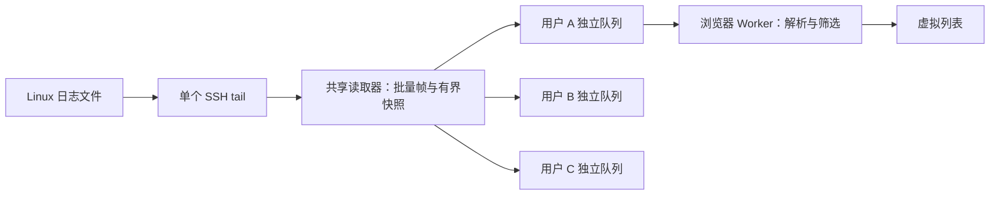

# 共享日志读取与前端筛选：性能验证

日期：2026-11-02。结果来自本机 Windows 开发环境，应用为 .NET 10 Debug / Development，16 个逻辑 CPU，Node.js 24.18.0，SQLite；PostgreSQL 17.11 另做回归。目标 Windows Server 2022 VM 尚未进行容量验收。

版本说明（2026-11-03）：本文为 SSH tail 读取器的历史测量。当前实现已改为服务端通过 SFTP 按偏移读取，活跃时约每 250ms 轮询、空闲时退避到 2s；本文延迟、吞吐和轮转验证不代表当前版本。共享广播与前端处理架构继续保留，当前结果以对应提交的 CI 和后续目标环境验收为准。

## 改动与读取逻辑



同主机连接身份、绝对路径和编码共享一个上游读取。不同账号的应用权限、订阅配额、审计和退出分别处理；不同 SSH 凭据、编码不会共用缓存。共享仅在一个应用进程内生效。

广播不等待客户端，慢订阅单独隔离；其资源保留到传输完成清理，期间继续占用配额。最后一个订阅退出后 3 秒释放上游。日志正文不写数据库，管理员状态接口为 `/api/streams/status`。

## 服务端负载结果

使用真实 SSH 协议的受控 SSH/SFTP 服务和独立认证的 SignalR 客户端。一个合成文件混合 ISO 前缀、JSON、普通文本和自定义字段，平均约 160 字节/行，包含中文、序号和生成时间。每档先预热 3 秒，再测量约 15 秒；逐订阅检查每条测量行的序号、数量和延迟。旧版与新版 8 订阅对照均使用 8 个独立账号。

| 场景 | 用户 / 订阅 | 文件生成速率 | 实际 SSH 读取数 | P95 延迟 | 应用 RSS 峰值 | 应用 CPU¹ | 缺行/重复 |
|---|---:|---:|---:|---:|---:|---:|---:|
| 优化前对照 | 8 / 8 | 1,000 行/秒 | 8 | 6ms | 187.66 MiB | 1.39% | 0 |
| 共享读取 | 8 / 8 | 1,000 行/秒 | 1 | 50ms | 186.86 MiB | 1.34% | 0 |
| 共享读取 | 8 / 32 | 1,000 行/秒 | 1 | 53ms | 197.03 MiB | 1.62% | 0 |
| 共享读取 | 8 / 32 | 5,000 行/秒 | 1 | 43ms | 167.42 MiB | 2.57% | 0 |
| 共享读取 | 16 / 64 | 1,000 行/秒 | 1 | 56ms | 204.16 MiB | 5.25% | 0 |

¹ CPU 为 .NET 应用进程 CPU 时间除以墙钟时间及 16 个逻辑 CPU，100% 表示整机算力。压测生成器、客户端、数据库和浏览器进程不包含在此列；RSS 为采样进程工作集。不同档次的 GC、线程池状态不同，内存或 CPU 不能据此作线性推算。

- 相同 8 人场景的 SSH 日志有效载荷由 **1.211 → 0.152 MiB/s**，约减少 87.5%。这是 SSH 明文有效载荷统计，不是含加密/协议开销的网卡抓包。
- 新增默认 40ms 批量发送，因此低负载延迟高于原先逐块直推；实测仍在数十毫秒。该批量时延是有意的吞吐与延迟取舍。
- 32 订阅 × 5,000 行/秒共完整交付 **2,403,040 行**，向客户端的正文有效载荷约 **24.37 MiB/s**。共享减少上游连接和读取，向每个客户端的分发仍随订阅数增长；SignalR JSON 转义和协议开销还会增加实际网络量。
- 用真实 WebSocket/TCP 客户端暂停接收，在其他正常订阅继续读取的同时，验证慢订阅被隔离且只有一个上游读取器。所有订阅退出后，读取器和订阅配额最终均归零。

原始测量数据见 [SQLite 完整报告](benchmarks/2026-11-02-shared-streams.json)。测试并未寻找系统崩溃点或最大容量。

### PostgreSQL 回归

PostgreSQL 17.11 使用全新测试数据库，完整 API/SSH 权限、扫描、下载、共享订阅、撤权及停用检查通过。另执行 8/32 订阅各 10 秒、约 1,000 行/秒的短压测：均只有一条 SSH 读取，无缺行/重复；P95 分别 49/53ms，应用 RSS 峰值分别 207.09/211.88 MiB。该资源统计不包含 PostgreSQL 进程。见 [PostgreSQL 测量数据](benchmarks/2026-11-02-postgres-streams.json)。

## 真实 Linux / WSL 验证

Ubuntu 26.04 WSL2、OpenSSH 10.2、GNU tail 9.7：8 个 Viewer 账号、32 个独立 SignalR 连接同时读取同一个真实文件；在 Linux 上检查只有一个 tail 进程。写入 5,000 行后，每订阅均收到 5,000 行，共 **160,000 行**，无缺行/重复，**P95 46ms**，写入与收齐总耗时 5.208 秒。

同时通过真实 SFTP、特殊字符路径、分页、下载 SHA-256、uutils/GNU tail 的追加/截断/轮转/重建、双窗格浏览器操作。现有 `/var/log/dpkg.log.1` 只读下载 362,531 字节，SHA-256 和最后 200 行一致。临时 SSH 服务、账号、文件已清理。

## 前端与格式验证

Chromium 1440×940，单窗格每秒 5,000 行，约 10.37 秒交互测量：

- Worker 内文本/通配符/正则筛选、排除、纯文本模式、无效正则恢复、冻结后继续筛选和恢复实时显示均通过。
- 虚拟列表渲染节点少于 200；达到窗口上限淘汰旧行；没有页面异常。
- 平均 requestAnimationFrame 约 **60.09 次/秒**，测量窗口没有大于 50ms 的主线程 long task。该短窗口结果不代表所有终端、规则与多窗格场景的表现。
- 主页面 JS heap 约 **16.3 MiB**，不含 Worker、Chromium 原生内存和其他浏览器进程；不能作为整个浏览器的内存用量。

格式单元检查覆盖正文误含 ERROR、明确前缀、syslog PRI、嵌套 JSON、Pino、.NET、OpenTelemetry 数值等级、纯文本和自定义捕获组；另验证上下文/排除优先、无效规则保留上一规则、行/字符缓冲边界、超长行和冻结快照。

RE2JS 2.9.1 用于用户模式匹配，避免使用浏览器原生回溯正则处理不受控规则。规则最大 512 字符，不支持环视和反向引用。它提供线性时间匹配，仍需限制规则和输入大小。[RE2JS 官方文档](https://github.com/le0pard/re2js)

等级识别只是可配置辅助：无法识别时使用中性色；不是完整事件解析器。JSON 数值映射按字段区分 .NET、syslog、Pino 与 OpenTelemetry，不能假设所有数字采用同一标准。[OpenTelemetry 等级定义](https://opentelemetry.io/docs/specs/otel/logs/data-model/)

## 配额与内存边界

| 项目 | 默认值 |
|---|---:|
| 每用户 / 每主机 / 全局订阅 | 4 / 128 / 512 |
| 每主机 / 全局独立文件读取 | 8 / 32 |
| 每订阅队列 | 64 帧且不超过 262,144 UTF-16 字符 |
| 每读取器快照 | 最近约 200 行且不超过 131,072 字符 |
| 批量发送 / 最大数据帧 | 40ms / 32,768 字符 |
| 每窗格实时缓冲 | 10,000 行且不超过 2,000,000 字符 |
| 单行显示 / 主线程待发 Worker 文本 | 16,384 / 1,000,000 字符 |

冻结显示会额外保留一份有界快照；传输层、对象与序列化也会消耗内存。配置容量不等于实际常驻内存，更不是已测吞吐量。客户端筛选只减少显示内容，不能减少 SSH、SignalR 流量或搜索窗口之外的历史。

## 复现

先执行 README 的依赖安装、前端构建和后端构建，再从仓库根目录运行：

```powershell
dotnet run --project tests/DWorkBench.CoreChecks
node tests/log-processing.mjs
node tests/integration.mjs
node tests/load.mjs
$env:WSL_LOAD = '1'
node tests/wsl-integration.mjs
```

`LOAD_SECONDS` 设置每档测量秒数（默认 15）；`LOAD_SHORT=1` 仅测 8/32 订阅的 1,000 行/秒；`SKIP_BROWSER=1` 跳过浏览器；`LOAD_BROWSER_ONLY=1` 只测前端；`LOAD_REPORT` 指定报告路径。报告默认写 `.local/load-results.json`，测试使用独立应用存储和回环测试服务器，不连接用户配置的真实主机。登录速率限制保持正常生效，扩展到 16 账号前会等待限制窗口。

`LOAD_BASELINE_DLL` 可选指向升级前保存的完整构建目录中的 DLL，追加旧版 8 人对照。应在修改前保留对应构建；只复制一个 DLL 不足以复现旧版运行依赖。没有基线时跳过对照，不影响新版压测。

PostgreSQL 请创建全新专用测试库，设置 `TEST_DATABASE_PROVIDER=Postgres` 与 `ConnectionStrings__DWorkBench` 后分别运行集成与压测脚本；每次重新创建测试库。不要指向业务库。现有 GitHub workflow 增加了短压测和核心检查，本次未触发远程 CI。

## 结论与待测范围

本次验证共享读取、正常客户端完整交付、慢消费者隔离和前端有界处理可用。测试是单机回环 HTTP/WebSocket，无 TLS、无生产网络 RTT；负载为同一文件，不能代表多个不同文件和主机的组合上限。真实 WSL 验证补充了 Linux 文件与 tail 路径，但仍非目标管理网络。

尚未进行长时间 soak、多用户真实浏览器并行、多窗格同时高负载、HTTPS/代理、目标 VM vCPU 与磁盘竞争、数据库长期审计增长的容量测量。因此当前默认 128/512 订阅限制是保护配额，**不能作为生产容量承诺**。发布到目标 VM 后，应以团队实际日志行长、独立文件数和浏览器数量重跑并调整配额。
