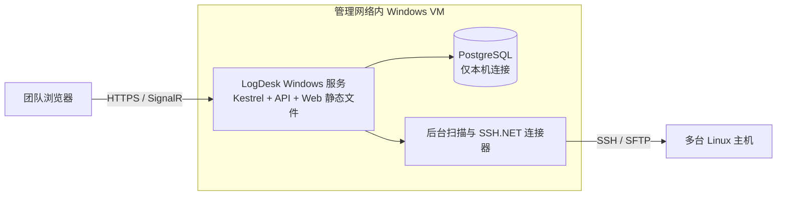

# LogDesk 技术方案

- 文档版本：0.5
- 日期：2026-11-02
- 状态：MVP 已实现；本地构建、受控及真实 WSL SSH/SFTP、SQLite/PostgreSQL、uutils/GNU tail 与 Chromium 已验证；目标 VM 部署待验收

## 1. 方案概要

团队共享配置、资源权限和操作审计需要一个中心化服务。MVP 采用 B/S：Windows 用户通过浏览器访问 LogDesk，服务端统一保存团队数据并从管理网络连接 Linux 主机。首版不接 SSO，不部署 Rundeck 或 Ansible；未来身份认证通过 OIDC 扩展，批量运维通过 Ansible 执行器扩展。

| 层 | 建议 | 用途 |
|---|---|---|
| 浏览器 UI | React + TypeScript | 日志清单、覆盖式抽屉、可调整多窗格和团队管理页面 |
| 应用/API | ASP.NET Core、C#、.NET 10 LTS | 用例、会话认证、资源授权、审计和管理 API |
| 实时推送 | ASP.NET Core SignalR | 将授权后的日志分块推送到浏览器 |
| SSH/SFTP | SSH.NET | 远程目录枚举、下载和固定模板的 tail 流 |
| 数据库 | PostgreSQL | 共享主机/来源/日志组、账号权限、文件元数据和审计 |
| 本地身份 | ASP.NET Core Identity | MVP 本地账号、密码散列、登录锁定；未来追加 OIDC 登录提供方 |
| 后台执行 | ASP.NET Core BackgroundService | MVP 同一服务进程中执行扫描、下载和连接调度任务 |
| 部署 | 管理网络内现有 Windows Server 2022 VM；Windows 服务 + Kestrel HTTPS | 用户已确认 VM 可通过 SSH 访问全部目标 Linux；同机原生运行 PostgreSQL，MVP 不依赖 WSL |

首版保持单一部署单元：Web/API、后台执行器和 SignalR 托管在同一应用实例，PostgreSQL 提供持久化。SSH 连接和数据访问放在可替换接口后；目前不需要 Kafka、Redis、Rundeck、AWX 或独立 SSH Agent。

实现位于 src/LogDesk.Server 与 src/LogDesk.Client，服务端按 Domain/Application/Infrastructure 目录组织。为本地开发额外支持 SQLite，Production 环境拒绝该配置。完整启动、发布、初次初始化和 Windows 服务安装流程见 [部署说明](DEPLOYMENT.md)。Linux CI workflow 已定义，尚未从本机执行 Linux 环境验收。

## 2. 总体结构

团队浏览器通过 HTTPS/SignalR 连接 LogDesk Web/API。Web/API 调用本地身份与资源授权、PostgreSQL 和后台扫描/下载/SSH 调度。后台任务经 SSH.NET 连接多台 Linux 主机的 OpenSSH、SFTP 和 tail。后续可以把 SSO 和 Ansible 执行器接到对应接口。

MVP 部署在已确认能访问全部目标主机的 Windows VM。浏览器经 HTTPS 访问同一 Web 服务，SSH.NET 在服务进程中发起出站 SSH/SFTP；tail 命令运行在远端 Linux 上。浏览器不接收 SSH 凭据。若以后主机分属互相隔离的网络区，可在各区增加执行节点，不需要在每台 Linux 主机安装 LogDesk Agent。

### 建议的项目边界

- **LogDesk.Web**：ASP.NET Core API、SignalR Hub、认证与授权中间件；承载静态 Web 前端。
- **LogDesk.Application**：日志扫描、开始/停止流、下载、用户/权限管理等用例；定义接口和审计要求。
- **LogDesk.Domain**：用户授权范围、服务器连接、日志源、日志组、远程文件及审计事件等业务规则。
- **LogDesk.Infrastructure.Ssh**：SSH.NET 适配器、SFTP、tail 流、主机指纹校验和并发调度。
- **LogDesk.Infrastructure.Persistence**：EF Core/Npgsql、PostgreSQL schema、应用配置和审计存储。
- **LogDesk.Worker**：后台执行接口与任务协调；MVP 可作为 Web 应用中的 Hosted Service，不单独部署。
- **LogDesk.Client**：React + TypeScript 的浏览器 UI；通过 HTTPS API 和 SignalR 访问服务端。

先按模块分层，不必把每个模块拆成独立部署服务。未来增加 SSO、Ansible 或多网络区执行节点时，依赖方向保持为 Web/API → Application 接口 → 具体 Infrastructure 适配器。

### Windows / Linux 兼容策略

当前就保持核心代码和数据格式的可移植性，MVP 正式部署支持和完整验收集中在 Windows Server 2022。Linux 环境的安装、服务管理、完整集成验证和性能验收在实际迁移时补齐。编译成功只代表初步兼容，不等于已经支持 Linux 生产部署。

| 关注点 | 现在的开发约束 | Linux 部署时补齐 |
|---|---|---|
| .NET 目标 | Web、Application、Domain 和通用 Infrastructure 使用 net10.0；Windows 专用 API 留在宿主配置/适配器中 | 按目标发行版、CPU 与 libc 发布对应运行包并验证 |
| 服务生命周期 | 业务后台任务使用通用 Hosted Service；Windows 服务管理器接入集中在宿主启动处，按平台启用 | systemd 服务单元或容器托管、服务身份与自动恢复 |
| 本机路径 | DataRoot、KeyRingPath、TempPath、LogPath 来自部署配置；D:\LogDesk 仅为 Windows 默认值；本机路径用标准 Path API | 改为 Linux 绝对路径、挂载目录和权限，验证大小写差异 |
| 远端 Linux 路径 | 始终按 POSIX 路径与大小写语义处理；不使用 Windows 的 Path.Combine/GetFullPath 拼装或规范化远端路径 | 保持相同远端行为，无需按服务端系统改写 |
| 证书/凭据 | Data Protection、X.509 保护方案独立于 Windows 用户身份；证书加载源可配置，Windows 默认从证书存储读取 | 通过受限文件/Secret 挂载加载同一保护证书及私钥，完成旧凭据解密验证 |
| 日志/配置 | 业务使用 ILogger 与标准配置系统；Windows 事件日志仅作为宿主可选输出；不依赖注册表保存业务数据 | 接入标准输出/journald 或部署环境日志收集 |
| 数据持久化 | PostgreSQL schema 与迁移脚本保持平台无关，配置不含嵌入业务逻辑的盘符 | 使用逻辑备份/恢复或数据库服务迁移；不把 Windows 数据目录直接复制为 Linux 数据目录 |

项目创建后启用 .NET 平台兼容性分析，明确标记/防护 Windows 专用 API 调用。在具备 CI runner 时增加 Windows/Linux 的基础构建和平台无关逻辑验证，及早发现路径、文件名大小写和平台依赖问题；实际 SSH 流、下载、凭据恢复和服务重启仍需在正式目标环境做集成验收。无需为基础 CI 给生产 VM 增加 WSL。

Data Protection 明确设置稳定的 ApplicationName 和 purpose。迁移时携带数据库逻辑备份、key ring、保护证书及私钥、必要配置，并保持这些标识和兼容版本一致，验证可解密已有 SSH 凭据。不能因安装目录变化而默认使用不同的应用隔离标识。

以上约束只隔离已知平台差异，不为尚未存在的运行环境增加一整套抽象。Windows/Linux 上的日志清单、权限、审计、SSH 会话和限流继续使用同一业务实现。

依据：[微软：可移植应用的目标框架](https://learn.microsoft.com/en-us/dotnet/standard/frameworks/)、[平台兼容性分析](https://learn.microsoft.com/en-us/dotnet/standard/analyzers/platform-compat-analyzer)、[Data Protection 应用隔离配置](https://learn.microsoft.com/en-us/aspnet/core/security/data-protection/configuration/overview?view=aspnetcore-10.0#set-the-application-name-setapplicationname)。

## 3. 团队数据与权限模型

| 对象 | 主要字段/用途 |
|---|---|
| AppUser | 内部用户 ID、登录名、密码散列、启停状态、创建与最近登录时间 |
| Role / PermissionGrant | 用户或角色、资源类型、资源 ID、允许动作 |
| ServerConnection | 名称、主机、端口、用户名、凭据引用、固定的主机指纹 |
| LogSource | ConnectionId、名称、远端目录、文件名 glob、文本编码 |
| LogGroup / LogGroupSource | 共享日志组及其跨主机来源关联 |
| RemoteLogFile | 来源、远端路径、文件名、大小、修改时间、最近扫描时间、扫描代次 |
| AuditEvent | 操作者、UTC 时间、动作、目标资源、结果、客户端地址、请求关联 ID、安全元数据 |

首版是一个团队/一个工作区，不实现多租户。共享的服务器、日志源和日志组存于 PostgreSQL；日志文件正文只从远端流到有权限的会话，不存入数据库。RemoteLogFile 仅保留目录扫描得到的元数据。

### MVP 权限规则

- 系统角色模板：**管理员**（用户、连接、凭据、权限和全局设置）、**维护者**（获授权范围内管理日志源/日志组并读取日志）、**查看者**（获授权范围内扫描、流式查看；下载能力可单独授权）、**审计员**（查看审计记录）。
- PermissionGrant 可授予日志组级或主机级动作；组中某条来源只有在用户同时获准访问该日志组和来源所在主机时才可见。这样跨主机日志组可向不同团队成员呈现各自有权访问的来源子集。
- 管理服务器连接和 SSH 凭据只授予管理员。首版不开放任意命令执行。
- 每个 API 请求都在服务端进行授权。配置日志组来源时，维护者还需拥有对应主机的配置权限；删除或修改底层服务器连接仍需管理员权限。
- UI 隐藏无权限的操作只用于改善体验，不构成安全边界。SignalR Hub 的订阅、历史回放和每个扫描/下载请求也要单独授权。
- 未获授权的连接、日志源和文件不应通过 API 返回名称或敏感元数据。

首版使用 ASP.NET Core Identity 管理本地账号。管理员在部署初始化时创建首个账号，并负责新增、停用和重置用户；不开放公开注册。内部用户 ID 与登录名分离，后续将外部 OIDC 的稳定 subject 映射到内部 ID，避免权限直接绑定邮箱。

## 4. 认证、审计与凭据安全

### 本地账号与后续 SSO

- MVP 仅启用本地账号和服务端 cookie 会话；使用 ASP.NET Core Identity 的密码存储和登录防护，配置失败锁定、HTTPS、Cookie 安全属性和防 CSRF。
- 不自行实现密码散列或认证协议。管理员创建/重置账号；密码重置不通过日志或审计事件传递。
- SSO 暂不启用。后续增加 OIDC Provider 时保持同一内部 AppUserId 和 PermissionGrant，使身份提供方变化不迁移资源授权。
- MVP 应限制在团队内网/VPN 访问，不直接对公网开放登录页面。

### 审计

应用显式写入 append-only AuditEvent，不能依赖 Web 服务器访问日志代替业务审计。至少记录：

- 登录成功/失败、用户启停和密码重置。
- 服务器、日志源、日志组与权限配置的创建、更新和删除。
- 主机连接测试、目录扫描开始/完成/部分失败。
- 日志流开始/停止/断开、文件下载开始/完成/失败。
- 授权拒绝和重要管理操作。

每条记录包含内部操作者 ID、UTC 时间、动作、目标资源、结果、请求关联 ID 和适当的客户端地址。不得记录密码、私钥、访问令牌或日志正文。审计 UI 不允许普通用户修改或删除记录；按保留策略归档和清理需后续制定。

### SSH 凭据

- 首版支持每个服务器连接配置一个 SSH 账号密码；凭据只在服务端加密保存，浏览器只传输一次性 TLS 请求，不持久化凭据。
- 使用 ASP.NET Core Data Protection 加密 SSH 凭据，数据库仅保存密文。key ring 存储路径通过 KeyRingPath 配置，Windows 部署默认 D:\LogDesk\secrets\keys；以独立的 X.509 证书保护。证书加载源通过配置选择，Windows 默认从本地计算机证书存储读取，未来 Linux 可从受限文件读取；应用服务身份获授读取私钥所需的权限。密钥目录限制服务身份与必要管理员访问，数据库和解密材料分开备份并受保护。
- 备份/恢复必须同时验证数据库与密钥环可恢复；密钥轮换与解密旧凭据要有演练。将来有现成密钥管理服务时，再用 CredentialStore 适配器接入。
- 凭据读取仅限服务端 SSH 连接组件；除非重新输入，不在 UI 回显已保存密码。应用诊断日志不输出认证载荷。
- Linux 侧建议创建只读、限目录账号；管理员确认 SSH 主机 SHA-256 指纹后固定保存，后续指纹变化时拒绝连接并要求复核。

ASP.NET Core Data Protection 是应用使用的数据保护层，Windows DPAPI 可以作为其 key ring 的静态加密机制。当前方案选择 X.509 保护 key ring，便于规划迁移和恢复；密钥不绑定到临时登录的管理员账户。显式指定 key ring 目录后，也必须显式配置其加密机制。[微软：密钥静态加密](https://learn.microsoft.com/en-us/aspnet/core/security/data-protection/implementation/key-encryption-at-rest?view=aspnetcore-10.0)

## 5. 远程日志流程

### 5.1 清单扫描

1. 浏览器请求扫描某个日志组或选定来源；API 先校验用户对该组/来源的访问权限并写入扫描审计事件。
2. 查询 PostgreSQL 中上次扫描的文件元数据并立即返回，标注快照时间；过期来源进入后台刷新队列。
3. MVP 后台调度器使用全局并发上限和每主机单并发，按来源渐进执行 SFTP 目录枚举；一个来源失败不阻塞其他来源。
4. 仅对文件 basename 执行 glob 匹配，过滤目录和非普通文件；元数据分批写 PostgreSQL 并推送进度。
5. API 只返回用户有权访问的来源及文件元数据；以 keyset/cursor 分页，每页约 100–200 项。

SFTP 对大目录枚举通常仍需读取全部目录项；分页和虚拟化解决 UI/数据库内存占用，但不会消除远端 O(N) 枚举成本。超大平面目录后续再评估受控的固定模板 find 扫描或目录分片。

### 5.2 流式查看

1. 用户显式选择文件后，服务端独立校验该订阅的账号、日志组和主机权限。每 5 秒复核授权、安全戳、主机连接身份、文件路径和编码；撤权只结束相应订阅。
2. 单进程 `SharedLogBroker` 按“主机 ID + 地址/端口/账号/指纹/凭据密文摘要 + 绝对路径 + 标准化编码”合并读取。同一文件经不同来源或日志组访问时可以复用；不同凭据或编码隔离。每位用户的授权仍逐次执行。
3. 首个订阅由 SSH.NET 建立读取，执行 `tail -n 200 -F -- '<remote-path>'`。路径严格按 POSIX 单引号规则转义；文件名模式不进入 shell。读取预检使用短期 SFTP 会话，后续一条 SSH tail 持续跟随。
4. 上游原文按 40ms 或 32,768 字符批量广播；每个订阅独立有界队列，最多 64 帧且不超过 262,144 字符。广播不等待消费者；慢订阅收到可理解的错误，其他订阅继续。已隔离但仍待传输清理的订阅继续占用配额，避免反复重连积累队列。
5. 每个读取器保留最近约 200 行、最多 131,072 字符的原文快照。新订阅的注册、快照和实时帧发布共用同步边界与序号，避免加入时丢帧或重复；达到字符上限给出提示。`WatchV2` 返回 ready/snapshot/data/notice 帧，旧 `Watch` 接口保留兼容。
6. 停止或断开只取消对应订阅。最后一个订阅离开后保留 3 秒短暂宽限以吸收快速切换，随后取消 tail 并释放 SSH；服务停止则取消全部读取器。重新打开读取最近快照，不能保证补齐中断期内容。
7. `tail -F` 按路径跟随轮转。真实 WSL 验证覆盖 GNU coreutils 9.7 和 uutils 0.8.0 的追加、截断、轮转和删除重建；其他 tail 实现及 SFTP-only 主机仍需实际验证。

默认每用户 4 订阅、每主机 128 订阅、全局 512 订阅；独立读取器每主机 8、全局 32。扫描和下载另设配额。管理员可从 `/api/streams/status` 读取当前读取器、活动/清理中订阅、缓冲、慢订阅隔离次数和生效配额。此状态端点不返回凭据或日志正文。

共享范围限单个应用进程；横向多实例时需按文件分配执行节点或引入专门流服务，本次不引入 Redis/Kafka。文件别名、符号链接和不同主机配置不会自动认定为同一物理文件。实测与边界见 [性能报告](PERFORMANCE.md)。

### 5.2.1 浏览器处理与格式适配

- 每关注会话独立 Web Worker 维护 10,000 行 / 2,000,000 UTF-16 字符环形缓冲；16,384 字符以上的单行截断并计数。主线程待处理文本上限 1,000,000 字符，一次只发送一批给 Worker，超载停止本窗格并提示。
- Worker 增量解析、匹配并约每 100ms 推送差量；只有规则变更时重新筛选保留窗口。React 虚拟列表仅渲染视口附近行。规则输入 150ms 防抖。
- 包含/排除支持文本、整行通配符和 RE2JS 正则，附大小写、等级范围与前后 0/2/5/10 行上下文；排除优先。正则最多 512 字符，拒绝环视和反向引用，规则无效时保留上一有效规则。[RE2JS 官方说明](https://github.com/le0pard/re2js)
- 等级自动识别仅采用明确行首等级、syslog PRI 或已知 JSON 等级字段；正文出现 ERROR 不直接标错。提供纯文本中性色、JSON 字段路径、自定义正则第 1 捕获组；未知格式保持中性。支持字符串等级、Pino 数值、syslog 数值、.NET LogLevel 与 OpenTelemetry SeverityNumber。
- 冻结显示会保留独立的有界快照，同时继续接收至实时环形缓冲；可筛选冻结内容，恢复时显示当前保留窗口。长时间冻结仍会淘汰实时窗口旧行，不承诺保存完整历史。
- 筛选和格式偏好按浏览器中的主机/路径保存。筛选只影响当前显示，不减少 SSH 或 WebSocket 流量，不改变下载原始字节，不执行远程全文搜索。

### 5.3 下载

1. 用户发起下载时，服务端验证日志组/主机授权并记录审计。
2. SSH.NET SFTP 读取开始时的文件长度，异步分块传输到短期临时文件或流式 HTTP 响应，不将整个文件载入内存。
3. 对外提供下载时以安全文件名和内容类型响应；日志正文不落入长期存储。传输失败删除临时文件并记录失败结果。
4. 若远程文件在传输期间增长，下载范围固定为启动时的长度并向用户说明。

## 6. 大清单与性能

- **共享缓存**：使用 PostgreSQL 保存跨请求、跨用户可复用的文件元数据快照，按来源隔离、带扫描代次和更新时间。切换组可先读缓存，不强制重扫。
- **批量写入**：SFTP 枚举在后台执行；元数据按批次事务 upsert，避免逐文件事务和逐行 UI 重绘。
- **结果读取**：索引至少覆盖 (SourceId, LastWriteTimeUtc DESC, FullPath)、(SourceId, Name) 和 (ConnectionId, FullPath)；筛选用 keyset/cursor 分页，限制每页数据量。
- **客户端渲染**：虚拟化清单长列表，只渲染视口附近行；日志窗格按块追加，SignalR 消息批量派发。
- **限流**：全局/主机级扫描、流和下载使用不同配额；同来源的重复扫描合并；单个用户不能通过开多个浏览器无限占满 SSH 会话。
- **有界缓冲**：每个关注会话最多保留约 10,000 行显示缓冲，超出后丢弃最旧内容并提示；实际行长设上限。
- **元数据保留**：已删除文件不立即擦除状态；扫描代次标记丢失条目，并按配置的保留期清理。正文永不进入元数据数据库。
- **性能边界**：目录枚举仍受远端目录大小、网络 RTT 和 SFTP 服务端实现影响。扫描进度按来源展示，不把单个主机故障显示成全组失败。

## 7. 未来 Ansible 扩展

MVP 不部署或调用 Ansible。应用层为未来定义独立的 IJobExecutor/IOperationExecutor 接口；日志扫描、tail 和下载走 SSH.NET，批量变更、配置检查、服务控制等声明式操作可增加 Ansible Core 适配器。

后续优先增加一台具备目标主机网络可达性的 Linux 执行节点，Windows 控制面通过经过认证的执行接口提交任务并接收状态与结果。任务带应用操作者和审计 ID。只允许经审阅/版本控制的 Playbook 或应用内固定任务模板；不把用户提交的文本直接拼成 Shell 命令。MVP 的用户、主机和授权数据作为候选 inventory 输入，但是否由 LogDesk 管理 inventory、还是映射现有 Ansible inventory，需要集成阶段再决定。

引入前验证 Ansible control node、SSH 凭据传递、任务取消/超时、分主机结果回传、敏感输出遮盖和审计映射。Ansible 不支持原生 Windows 作为控制节点；虽然 WSL 可运行 Ansible，官方明确说明 WSL 不受支持且不应用于生产系统。因此团队正式使用的 Ansible 执行端优先采用独立 Linux 节点，WSL 仅作为可选的开发/验证环境，不能成为生产集成的默认路径。[Ansible：Windows 控制节点与 WSL 限制](https://docs.ansible.com/projects/ansible/latest/os_guide/intro_windows.html#using-windows-as-the-control-node)

其他候选：

- **Rundeck**：已覆盖分布式命令执行、工作流、密钥、RBAC 和历史审计；若未来希望采用成熟运维平台 UI，可再比较以它为平台还是只通过 API 委托批量作业。MVP 不部署。[Rundeck 介绍](https://docs.rundeck.com/docs/manual/01-introduction.html)
- **Apache Guacamole**：可作为后续浏览器 SSH 终端/SFTP 文件浏览模块，但不替代结构化日志清单、日志组授权和专用日志窗格。[Guacamole SSH/SFTP](https://guacamole.apache.org/doc/gug/configuring-guacamole.html)
- **OpenBao**：仅当需要集中密钥管理、短期凭据或 SSH CA 签名证书时评估；首版不增加独立密钥基础设施。[OpenBao SSH 引擎](https://openbao.org/docs/secrets/ssh/)

## 8. Windows VM 部署方案

当前已确认的条件：只有一台 Windows Server 2022 VM 位于管理网络，且能通过 SSH 访问全部目标 Linux。首版采用原生 Windows 部署，不要求额外 Linux VM、Docker 或 WSL。

| 已知配置 | 方案含义 |
|---|---|
| Windows Server 2022 | 按原生 Windows 服务部署 Web/API、后台任务与 PostgreSQL |
| CPU 主频 2.6 GHz | vCPU 数量和实际调度能力仍未知，不能只按主频推算并发量 |
| 内存 64 GB | 对轻量日志 MVP 有较大容量余地；仍限制 SSH 会话数、每会话缓冲与单行长度 |
| D 盘约 1 TB 可用空间 | 应用、PostgreSQL 数据、临时下载与诊断文件优先放在 D 盘；存储类型和 IOPS 尚未确认 |

硬件描述足以继续方案设计，不构成吞吐量或最大在线人数承诺。容量目标需结合 vCPU 数、网络、日志生成速率、目录文件数与同时打开的日志流确定。

| 组件 | 首版部署方式 |
|---|---|
| LogDesk 应用 | 一个 Windows 服务，托管 Kestrel、API、SignalR、前端静态文件及后台任务 |
| PostgreSQL | 同机安装，作为独立 Windows 服务运行；仅监听本机并使用独立应用数据库账号 |
| HTTPS | Kestrel 配置团队信任的服务器证书和内部域名；默认规划 TCP 443，若被占用则使用约定端口 |
| 前端发布 | React 构建产物随应用发布；VM 无需运行 Node 开发服务器 |
| 应用包 | 首选自包含 win-x64 发布包；最终按 VM 的 Windows 版本、架构和 .NET 支持范围确认 |
| 数据目录 | 应用放 D:\LogDesk\app；PostgreSQL 数据放 D:\LogDesk\data\postgres；密钥、临时下载与诊断文件分别放在 secrets、temp、logs 子目录并设置独立访问权限 |

- 采用 Microsoft.Extensions.Hosting.WindowsServices 接入 Windows 服务管理器，设置自动启动与失败恢复；RDP 注销后继续运行。后台任务和 Web/API 共用应用生命周期，停止服务时取消 SSH 会话并释放资源。
- 使用专用低权限服务身份运行应用，授予“作为服务登录”和必要目录/证书权限。所有路径显式配置，不依赖服务启动时的当前工作目录。
- 团队浏览器必须能访问 VM 的 HTTPS 端口；防火墙入站规则限制为团队网段/VPN。VM 向目标 Linux 发起出站 SSH（默认 TCP 22，支持配置端口），PostgreSQL 端口不对用户网络开放。
- MVP 推荐 Kestrel 直接提供 HTTPS，IIS 可在团队有统一托管要求时替换此托管方式。Windows 服务端点使用正式配置且受团队信任的证书，不能依赖开发者个人的开发证书。
- PostgreSQL 与应用均使用稳定版本；具体 PostgreSQL 主版本需依据 Windows VM 版本和安装器支持矩阵选择。应用发布包包含 React 静态产物与 .NET 运行时，部署节点不需要 SDK；自包含运行时的安全更新通过重新发布应用包完成。
- PostgreSQL 保存用户、权限、审计、主机和文件元数据；数据库、key ring 与保护证书需有受保护的异机备份和恢复流程。临时下载目录设容量与过期清理策略。
- 单 VM 是 MVP 的可用性边界：VM 或应用重启会中断日志流和当前下载，服务恢复后用户重新打开；重连不承诺补齐中断期间的日志。远端日志仍保留在 Linux 上。升级前备份数据、记录 schema 版本并保留上一版发布包。
- 锁定 .NET SDK、NuGet 和 npm 依赖版本；正式发布前审阅依赖许可证、安全公告和操作系统兼容性。
- 将来按实际需求增加 Linux Ansible 执行节点、多网络区执行节点或多应用副本；应用授权、共享配置和审计仍留在中心服务。

依据：[ASP.NET Core 作为 Windows 服务运行](https://learn.microsoft.com/en-us/aspnet/core/host-and-deploy/windows-service?view=aspnetcore-10.0)、[PostgreSQL Windows 安装与支持矩阵](https://www.postgresql.org/download/windows/)。

### WSL 取舍

- Windows Server 2022 支持安装 WSL，但本机是 VM；运行 WSL 2 前还需要宿主虚拟化平台向此 VM 开放嵌套虚拟化。足够的内存和磁盘空间不等于具备此条件。
- 当前应用、PostgreSQL 和 SSH.NET 均按 Windows 原生部署；tail 在远端 Linux 执行。MVP 没有必须由本机 Linux 环境承担的功能，引入 WSL 不减少现有应用逻辑。
- WSL 会增加 Linux 发行版维护、网络路径、磁盘镜像、启动与恢复管理。当前决策是先保持 Windows 服务部署，WSL 可用于隔离的 Linux 工具试验，不能成为应用启动依赖。
- 后续 Ansible 正式执行端采用可访问目标主机的 Linux 节点；WSL 仅用于开发验证，并遵守 Ansible 对 WSL 生产使用的限制。

依据：[微软：Windows Server 上安装 WSL](https://learn.microsoft.com/en-us/windows/wsl/install-on-server)、[微软：在 VM 中运行 WSL 2](https://learn.microsoft.com/en-us/windows/wsl/faq#can-i-run-wsl-2-in-a-virtual-machine)、[Ansible 的 WSL 支持限制](https://docs.ansible.com/projects/ansible/latest/os_guide/intro_windows.html#using-windows-as-the-control-node)。

## 9. 主要风险与缓解

| 风险 | 影响 | 缓解 |
|---|---|---|
| 本地账号暂时代替 SSO | 密码与离职账号生命周期由 LogDesk 承担 | 限内网/VPN；禁公开注册；管理员启停账号；锁定失败登录；后续 OIDC 映射内部用户 ID |
| 共享 SSH 凭据被滥用 | 主机侧看到服务账号，难以从 sshd 区分应用用户 | 应用层每个动作记录内部操作者；只读专用 SSH 账号；后续需要主机级归因时改用个人账户/短期 SSH 证书 |
| 数据库泄露暴露密码 | 可能扩展为多台 Linux 失陷 | DB 只存 Data Protection 密文；key ring 与保护密钥独立保管；限制管理员权限并演练恢复 |
| 权限只在 UI 隐藏 | API/SignalR 可被直接请求绕过 | 所有 API、下载、SignalR 订阅均做服务端资源授权；未授权不返回资源元数据 |
| 审计缺失或含敏感内容 | 无法追责或日志泄漏 | Application 用例统一写审计；记录动作/目标/结果而非日志正文、口令或密钥 |
| 一个目录包含数十万文件 | SFTP 枚举慢，清单更新延迟 | 后台渐进扫描、分批 upsert、虚拟列表、游标分页、缓存和扫描范围裁剪；显示扫描耗时 |
| 多用户同时流式查看 | SSH 会话和服务端内存耗尽 | 同文件共享读取；读取器/订阅独立配额；有界缓冲；慢订阅隔离；最后订阅退出后短暂宽限再释放连接 |
| 后端无法访问隔离区主机 | 对应来源失败 | 首版部署到可达管理区；后续按网络区配置执行节点 |
| 单 Windows VM 停机或重启 | 全部用户暂时无法访问，实时流与下载中断 | Windows 服务自动启动/恢复、异机备份；恢复后重新打开流；后续再规划高可用 |
| 主机指纹变化 | 中间人风险或合法重装误报 | 首连确认、指纹 pin；变化时阻断并要求管理员复核 |
| 特殊字符路径进入 shell | 命令注入或路径解析错误 | 固定 tail 模板、严格 POSIX 转义、文件名模式只在客户端/服务端本地匹配 |
| 后续引入 Ansible 与当前操作冲突 | 重复授权与审计体系、无法取消/追踪任务 | 通过 JobExecutor 接口隔离；任务继承应用授权与审计 ID；集成时定义单一执行记录来源 |

## 10. 官方资料

- [.NET 官方支持策略](https://dotnet.microsoft.com/en-us/platform/support/policy)：核对 .NET 10 LTS 生命周期。
- [ASP.NET Core Identity](https://learn.microsoft.com/en-us/aspnet/core/security/authentication/identity)：本地用户、密码和身份验证。
- [ASP.NET Core Data Protection](https://learn.microsoft.com/en-us/aspnet/core/security/data-protection/)：Web 场景的数据保护与密钥管理。
- [ASP.NET Core SignalR](https://learn.microsoft.com/en-us/aspnet/core/signalr/streaming)：实时服务端/客户端数据流。
- [SSH.NET 官方仓库](https://github.com/sshnet/SSH.NET)：SSH 命令、SFTP、认证、目标框架和许可证。
- [PostgreSQL 官方文档](https://www.postgresql.org/docs/current/)：事务、索引、JSON 与运维参考。
- [ASP.NET Core Windows 服务](https://learn.microsoft.com/en-us/aspnet/core/host-and-deploy/windows-service?view=aspnetcore-10.0)：服务身份、自动启动、Kestrel 和发布方式。
- [PostgreSQL Windows 安装](https://www.postgresql.org/download/windows/)：原生安装器及其支持矩阵。
- [Ansible Core 安装文档](https://docs.ansible.com/projects/ansible-core/devel/installation_guide/intro_installation.html)：控制节点与无代理执行模型。

## 11. 仍需确认

1. Windows Server 2022 VM 的 vCPU 数量、CPU 架构、磁盘类型/IOPS 和系统补丁情况；团队浏览器是否可访问 VM 的内部 HTTPS 地址，内部域名/证书如何提供？
2. 首批团队人数、主机数、日志源数和单目录文件量，用于制定容量与并发目标。
3. 本地账号的开通与重置方式：管理员手动发放，还是 MVP 就需要邮件邀请/找回？
4. 用户是否允许下载所有有权查看的日志，还是下载需要单独角色/审批？
5. 远端 Linux 是否都允许 SSH 密码登录、SFTP 和 GNU tail；后续是否要求跳板机或强制 MFA？

## 2026-11-02 关注会话与阅读视图

App 独立维护关注会话集合及最多两个阅读槽位。LogPane 控制器在后台保持挂载、SignalR 订阅与 Worker 不重建，未展开时不渲染正文。可见性消息让 Worker 在前台 100ms 推送行增量，后台只每秒推送活动摘要并定期清理待发布行；返回时重建有限缓存视图。阅读锚点以行 ID 保留，超出缓存明确提示。

LogActivity 使用最多约 60 个秒桶和最多 320 字符摘录。关注规则独立编译为 RE2/文本匹配器，非法规则保留上一有效规则；无等级推断。显式快照不计入实时活动，初次 SSH tail 的数据不可与历史精确区分，因此界面使用“接收量”而非“新增量”。断开、停止和重连在界面明示。

LogBuffer 的待发布增量同时受 20,000 行和 4,000,000 字符阈值约束，超出后只保留尚在环形缓冲中的行引用，避免后台低频发布时长行占用膨胀。原有每会话 10,000 行/2,000,000 字符、单行及主线程排队限制继续生效。

POST /api/sources/preview 使用相同 SourceInput 验证、固定指纹的 SFTP 和目录元数据读取。管理员可预览草稿；维护者必须指定可管理的既有 sourceId 且不能换主机。接口有请求速率、并发、返回数量、扫描项及超时边界，操作写入 source.previewed 审计。无数据库结构变更。

## 2026-11-03 账号工作台持久化

- schema 2 新增 Workspaces(UserId PK/FK, Revision, UpdatedAt, Document)，按当前认证用户读写一份显式版本化配置 DTO。schema 1 通过事务内增量建表升级；SQLite/PostgreSQL 使用相同逻辑，账号删除时级联删除配置。
- GET /api/workspace 返回自己的配置及当前可访问文件元数据；PUT /api/workspace 使用 OwnerId 防止账号切换时错写，并以 Revision 执行比较更新。首次创建竞争由唯一键处理，过期写入返回 409；没有跨账号 workspace 查询入口。
- POST /api/workspace/resolve 最多解析四个引用，重新检查当前日志组/主机授权、来源归属、目录/模式/编码及清单状态；单项返回 file 或 issue。恢复连接继续经过 LogsHub 和 RemoteLogs 的授权及真实文件检查，解析本身不打开 SSH 连接。
- 配置 DTO 仅含布局、资源引用、筛选及关注规则。JSON 请求最大 64 KiB，持久化文档最大 60,000 UTF-8 字节；最多四个关注项、两个阅读槽位，字符串与枚举分别验证。文件 ID 和资源显示名称重新查询，正文与接收状态不保存。
- 客户端显式提取可保存字段，合并 500ms 内的变化；只允许一条在途保存，请求完成后继续提交新变化。pagehide/隐藏页面尝试 keepalive 保存；本机草稿用于恢复尚未同步的配置，按账号隔离。服务器版本冲突交给用户选择，不自动覆盖。
- 恢复配置强制重新挂载会话控制器，全部初始化为 deferred，避免恢复时建立连接或保留旧 Worker/缓存。用户点击恢复后重新解析当前资源，随后独立启动对应订阅；元数据失效和远端连接错误分别呈现。
